# Mnemosyne (`v1.0.0`) — Obsidian-Native AI Study Engine & Cognitive Harness

> **Learn from Unconditional Truths. Derive by 3Blue1Brown Motivated Discovery. Verify via Blind Zero-Context Assessment. Schedule with Deterministic FSRS-4.5 + `obsidian-spaced-repetition`. Graduate from Fleeting Study Drafts into a Living Obsidian Zettelkasten.**

`mnemosyne` is an air-gapped, CLI-first, Obsidian-native AI Study Engine and Skills Harness that unifies the epistemological teaching philosophy of **`amosblomqvist/learn`** with the cognitive science, cryptographic claim-check blind grading, and FSRS-4.5 scheduling engine of **`nagisanzenin/engram`**.

---

## 1. System Architecture & C4 Component Topology

```mermaid
flowchart TB
    subgraph Harness["5 Core Skills (skills/*/SKILL.md)"]
        Learn["/learn\nAcquisition, Inbox Triage & Frontier Probe"]
        Review["/review\nInterleaved Retrieval & Lapse Re-Teach"]
        Visualize["/visualize\nTri-Modal Visual Director"]
        Synthesize["/synthesize\nZettelkasten Compiler & Graduation"]
        Coach["/coach\n25-Min Study Plan, Inbox, Refit & Gold Audit"]
    end

    subgraph Agents["6 Context-Isolated Subagents (agents/*.md)"]
        Researcher["mnemosyne-researcher\nPrimary Source & Axiom Verifier"]
        Architect["mnemosyne-curriculum-architect\nFirst-Principles DAG Builder"]
        Assessor["mnemosyne-assessor\nZero-Context Blind Examiner"]
        MermaidMaker["mnemosyne-mermaid-maker\nNative Mermaid Topology Author"]
        SVGMaker["mnemosyne-svg-maker\nSpatial & Memory Layout SVG Author"]
        ArtifactSmith["mnemosyne-artifact-smith\nOffline CSP HTML Explorable Builder"]
    end

    subgraph Engine["Deterministic Python 3.10+ Core (scripts/mnemosyne.py — Stdlib Only)"]
        VaultGate["VaultGate Sanctuary & Path Guard\n(Hard Exit Code 2 on 05 - Fleeting/quicknotes, non-mnemosyne Fleeting, .git, .obsidian)"]
        LockMgr["Re-Entrant POSIX PID Lock & Atomic I/O\n(.mnemosyne.lock + .mnemosyne_tmp_* + os.replace)"]
        DAGEngine["DAGEngine & Heavy-Path Binary Search\n(validate-dag, add-topic, next --frontier-of)"]
        StashEngine["Claim-Check Stash & Zero-Context Export\n(sid + stash_sha256 Verification)"]
        FSRSEngine["FSRS-4.5 Scheduler & sync-sr Bridge\n(W[0..16], Dose Caps, SR Inference)"]
        ASTEval["Safe AST Math Verifier\n(verify-expr: <=256 nodes, <=500ms, 5-Slip Check)"]
        MDCompiler["Span-Preserving YAML, Fleeting Drafts & Graduation Compiler\n(OCC st_mtime_ns + mnemosyne_body_hash)"]
    end

    subgraph Vault["Canonical Obsidian Vault (MNEMOSYNE_VAULT_PATH)"]
        Ledger[("99 - Meta/mnemosyne-state/\nlearner-model.json, topics/*.json,\nreceipts/*.jsonl, stash.jsonl, conflicts/")]
        Attach[("99 - Meta/attachments/\n<topic>-<node>.svg | -explorable.html")]
        FleetingMnem[("05 - Fleeting/mnemosyne/\ninbox/ (Study Seeds)\n<Topic>/<Node Title>.md (status: fleeting)")]
        MOCs[("00 - Maps of Content/\n<Topic> MoC.md")]
        Notes[("02 - Areas/ & 04 - Permanent/\nGraduated Zettelkasten Notes (status: permanent)")]
        Sanctuary[("05 - Fleeting/quicknotes/ (Omarchy Widget)\n05 - Fleeting/* (outside mnemosyne/) | .git/ | .obsidian/\n[INVIOLABLE SANCTUARY — EXIT CODE 2]")]
    end

    Learn --> Researcher & Architect & Assessor & Engine
    Review --> Assessor & Engine
    Visualize --> MermaidMaker & SVGMaker & ArtifactSmith & Engine
    Synthesize --> Engine
    Coach --> Assessor & Engine

    Engine --> VaultGate --> LockMgr
    LockMgr --> Ledger & Attach & FleetingMnem & MOCs & Notes
    FleetingMnem ==>|"Auto-Graduates on score >= 3\n(carries user prose, removes draft)"| Notes
    VaultGate -.->|"BLOCKED (sys.exit(2))"| Sanctuary
```

All state transitions, Study Inbox management (`inbox add` / `inbox list`), DAG validation, binary-search frontier bracketing, cryptographic Claim-Check stashing (`stash_sha256`), FSRS-4.5 mathematical scheduling, bi-directional `obsidian-spaced-repetition` reconciliation (`sync-sr`), Optimistic Concurrency Control (OCC), and Full Zettelkasten Graduation (`05 - Fleeting/mnemosyne/<Topic>/` $\rightarrow$ `02 - Areas/` or `04 - Permanent/`) are executed deterministically by a single zero-dependency Python 3.10+ standard-library CLI engine (`scripts/mnemosyne.py`).



---

## 2. Repository Layout

```text
mnemosyne/
├── .claude-plugin/
│   └── plugin.json                          # Plugin manifest (v1.0.0)
├── .gitmodules                              # Git submodule: vault -> git@github.com:zatzk/Obsidian.git
├── .gitignore                               # Ignores .mnemosyne_tmp_*, .mnemosyne.lock, __pycache__/
├── README.md                                # Architecture, CLI reference, and Vault guide
├── scripts/
│   └── mnemosyne.py                         # Zero-dependency Python 3.10+ deterministic engine
├── skills/
│   ├── _shared/
│   │   ├── pedagogy.md                      # Unconditional Truths, 3B1B Discovery, Binary-Search Probe, 8-Beat Loop
│   │   ├── rubrics.md                       # 1-4 FSRS rubrics, produced:false cap (<=2), JSON schemas
│   │   ├── visual-routing.md                # Content-affordance matrix (Mermaid / SVG / Offline CSP HTML)
│   │   ├── obsidian-conventions.md          # Sanctuary Law (Exit 2), Fleeting Graduation, Dual-Write YAML, Managed Blocks
│   │   ├── dialogue-grammar.md              # Companion reference for 8-Beat Dialogue Grammar
│   │   ├── rubric-contract.md               # Companion reference for Probe-Rubric Co-Authoring
│   │   ├── explorable-contract.md           # Companion reference for 7-Clause Explorable Contract
│   │   └── obsidian-frontmatter-spec.md     # Companion reference for Dual-Write YAML Frontmatter & Graduation
│   ├── learn/SKILL.md                       # /learn workflow
│   ├── review/SKILL.md                      # /review workflow
│   ├── visualize/SKILL.md                   # /visualize workflow
│   ├── synthesize/SKILL.md                  # /synthesize workflow
│   └── coach/SKILL.md                       # /coach workflow
├── agents/
│   ├── mnemosyne-curriculum-architect.md    # First-principles DAG author & validator
│   ├── mnemosyne-researcher.md              # Isolated primary-source fact checker
│   ├── mnemosyne-assessor.md                # Blind Zero-Context Grader
│   ├── mnemosyne-mermaid-maker.md           # Validated native Mermaid diagram author
│   ├── mnemosyne-svg-maker.md               # Spatial/geometric SVG author & verifier
│   └── mnemosyne-artifact-smith.md          # Offline CSP-locked interactive HTML explorable builder
├── hooks/
│   ├── hooks.json                           # SessionStart hook registration
│   └── session-start.sh                     # Ambient due-review & stale-stash notifier
└── gold/
    └── assessor-gold.jsonl                  # >=258 calibrated & adversarial grading items for assessor-audit
```

---

## 3. Core Pedagogical & Engineering Guarantees (`RN-01` .. `RN-10`)

1. **Receipts or It Didn't Happen (`RN-01`):** No concept node transitions from `new` to `learning`/`review`, graduates from `05 - Fleeting/mnemosyne/` to `02 - Areas/` or `04 - Permanent/`, updates its FSRS schedule, or earns a `✅` mastery badge in an Obsidian MoC without a cryptographically verified append-only receipt (`sid` + `stash_sha256`).
2. **Strict Separation of Powers (`RN-02`):** The conversational tutor is forbidden from assigning FSRS-driving grades. `mnemosyne.py stash export-assessor --sid <SID>` emits a context-stripped JSON envelope containing *only* `{sid, stash_sha256, topic, node, kind, event_kind, node_kind, claim, probe, rubric, production, produced, confidence}` for the isolated `mnemosyne-assessor`. Furthermore, if `"produced": false` (learner asked to be told or did not generate independently), the score is hard-capped at `score <= 2` (`partial` / `hard`).
3. **Binary-Search Prerequisite Frontier Probing (`RN-03`):** Before teaching a strand, the tutor brackets the learner's prerequisite frontier (`floor` and `ceiling`) in $\le \lceil \log_2 N \rceil + 2$ probes via `next --frontier-of`.
4. **Unconditional Truths & 3Blue1Brown Motivated Discovery (`RN-04`):** Every DAG node and compiled Obsidian note anchors first on a caveat-free **Unconditional Truth** (universal statement or generative definition) and walks through **Motivated Discovery** (*Pain before Pill* $\rightarrow$ *Concrete Special Case* $\rightarrow$ *General Abstraction*).
5. **Pre-Feedback Confidence Integrity (`RN-05`):** Confidence (`1..4`) is captured immediately after the learner's verbatim production and strictly *before* any evaluative cue from the tutor.
6. **Probe-Rubric Co-Authoring & `probe_gap` (`RN-06`):** Every rubric criterion must be necessitated by `probe` alone, and zero criteria may mirror facts stated in the probe's stem.
7. **Knowledge-Kind Routing & Safe AST Math Verifier (`RN-07`, `FR-11`):** Concepts use Socratic/Contrast-First derivation; Procedures use the 4-step Worked-Example Ladder and deterministic verification via `mnemosyne.py verify-expr` (distinguishing execution `"slip"` floored at $G=2$ from `"conceptual"` lapse $G=1$); Facts (`arbitrary: true`) route to mnemonics + spacing.
8. **Tri-Modal Self-Verifying Visuals (`RN-08`):** Visual subagents cap render-and-inspect loops at 3 iterations: `mnemosyne-mermaid-maker` outputs native ```` ```mermaid ```` fences; `mnemosyne-svg-maker` outputs verified SVGs to `99 - Meta/attachments/`; `mnemosyne-artifact-smith` outputs 100% offline CSP-locked HTML explorables to `99 - Meta/attachments/`.
9. **Dual-Write FSRS-4.5 $\leftrightarrow$ `obsidian-spaced-repetition` Bridge (`RN-09`, `ASR-05`):** Seamless review in either Obsidian UI or the CLI.
10. **Inviolable Vault Sanctuary & Full Zettelkasten Graduation (`RN-10`, `CON-03`):**
    - `VaultGate` enforces a hard block (`sys.exit(2)`) on `05 - Fleeting/quicknotes/` (Omarchy QuickNote widget in `~/.config/omarchy/shell.json`), any path inside `05 - Fleeting/` outside `05 - Fleeting/mnemosyne/`, `.git/`, and `.obsidian/`.
    - `05 - Fleeting/mnemosyne/` hosts the Study Inbox (`05 - Fleeting/mnemosyne/inbox/`) and fleeting study drafts (`05 - Fleeting/mnemosyne/<Topic>/<Node Title>.md`, `status: fleeting`), which automatically graduate to `02 - Areas/` or `04 - Permanent/` (`status: permanent`) upon passing blind assessment (`score >= 3`).

---

## 4. Obsidian Vault Setup, Sanctuary Partition & Zettelkasten Graduation

Mnemosyne resolves the canonical Obsidian Vault via `MNEMOSYNE_VAULT_PATH` (defaulting to `/home/ozymandias/GoogleDrive/Obsidian/Vault` when present, or the repository submodule `./vault/Vault`):

```bash
export MNEMOSYNE_VAULT_PATH="/home/ozymandias/GoogleDrive/Obsidian/Vault"
python3 scripts/mnemosyne.py init
python3 scripts/mnemosyne.py doctor
```

| Vault Path | Role, Lifecycle Stage & Access Policy |
| :--- | :--- |
| **`05 - Fleeting/quicknotes/`** *(and `05 - Fleeting/*` outside `mnemosyne/`)* | **INVIOLABLE SANCTUARY — Hard Exit Code `2` on any access attempt.** Reserved for the user's Omarchy QuickNote widget (`~/.config/omarchy/shell.json`) and private fleeting notes. |
| **`05 - Fleeting/mnemosyne/inbox/`** | **Study Inbox (`inbox add` / `inbox list`):** Raw study ideas, questions, and reading notes dropped by the user or CLI to be picked up by `/coach` and `/learn`. |
| **`05 - Fleeting/mnemosyne/<Topic>/<Node Title>.md`** | **Fleeting Study Drafts (`status: fleeting`):** In-progress / unmastered nodes (`learning`, `relearning`, `score <= 2`, or stashed drafts). |
| **`00 - Maps of Content/<Topic> MoC.md`** | Auto-synthesized Topic Maps of Content with Mermaid dependency graphs (`✅`, `🔄`, `🔒`) and `[[Wikilinks]]`. |
| **`02 - Areas/<Domain>/<Topic>/<Node Title>.md`** *(or `02 - Areas/<Domain>/`)* | **Graduated Domain Notes (`status: permanent`):** Auto-graduated from `05 - Fleeting/mnemosyne/<Topic>/` once `score >= 3` (`review` state) when `note_target: "02 - Areas"`. |
| **`04 - Permanent/<Node Title>.md`** | **Graduated Evergreen Notes (`status: permanent`):** Auto-graduated from `05 - Fleeting/mnemosyne/<Topic>/` once `score >= 3` (`review` state) when `note_target: "04 - Permanent"`. |
| **`99 - Meta/00 - Templates/`** | Read-only note templates. |
| **`99 - Meta/attachments/`** | Verified `.svg` diagrams, interactive `-explorable.html` files, and `report.html`. |
| **`99 - Meta/mnemosyne-state/`** | Authoritative JSON/JSONL ledger (`learner-model.json`, `topics/*.json`, `receipts/*.jsonl`, `stash.jsonl`, `misconceptions.json`, `experiments.json`, `conflicts/`). |
| **`.git/`**, **`.obsidian/`** | **INVIOLABLE SANCTUARY — Hard Exit Code `2` on any access attempt.** |

### Full Zettelkasten Graduation Lifecycle
1. **Study Inbox (`05 - Fleeting/mnemosyne/inbox/`):** Drop raw topic ideas or questions into `05 - Fleeting/mnemosyne/inbox/` (or run `python3 scripts/mnemosyne.py inbox add`). `/coach` and `/learn` list them via `python3 scripts/mnemosyne.py inbox list`.
2. **Fleeting Draft (`05 - Fleeting/mnemosyne/<Topic>/<Node Title>.md`):** While a node is in acquisition (`learning`, `relearning`, `score <= 2`, or stashed draft), `mnemosyne.py synthesize` writes the note to `05 - Fleeting/mnemosyne/<Topic>/<Node Title>.md` with `status: fleeting`.
3. **Permanent Graduation (`02 - Areas/` or `04 - Permanent/`):** Once the node passes blind assessment (`score >= 3` / `review` state), `mnemosyne.py synthesize` automatically graduates the note to `02 - Areas/<Domain>/<Topic>/` or `04 - Permanent/` with `status: permanent`, **carrying over any user prose written outside `<!-- mnemosyne:start/end -->` (and user YAML keys)** and **removing the fleeting draft** from `05 - Fleeting/mnemosyne/<Topic>/`.

---

## 5. FSRS-4.5 $\leftrightarrow$ `obsidian-spaced-repetition` Mathematical Bridge

### 5.1 Forward Mapping (`FSRS-4.5 -> Markdown YAML Frontmatter`)
When `mnemosyne.py synthesize` compiles a note (either as a fleeting draft in `05 - Fleeting/mnemosyne/<Topic>/` or a graduated note in `02 - Areas/` / `04 - Permanent/`), it preserves all user-owned YAML keys byte-for-byte (`SEC-YAML-01`) and dual-writes:
- **Zettelkasten Lifecycle Status:** `status: fleeting` (in `05 - Fleeting/mnemosyne/<Topic>/`) or `status: permanent` (in `02 - Areas/` and `04 - Permanent/`).
- **Native FSRS-4.5 Properties:** `fsrs_state`, `fsrs_stability` ($S$), `fsrs_difficulty` ($D \in [1, 10]$), `fsrs_due` (`"YYYY-MM-DD"`), `fsrs_last`, `fsrs_reps`, `fsrs_lapses`, `mnemosyne_topic`, `mnemosyne_node`, `mnemosyne_sid`, `mnemosyne_body_hash`, `mnemosyne_schema: 1`.
- **`obsidian-spaced-repetition` Properties (Unquoted Literals):**
  - `sr-due: YYYY-MM-DD` (matches `fsrs_due`)
  - `sr-interval: <int>` ($\max(1, \text{round}(\text{fsrs.interval}))$)
  - `sr-ease: <int>` ($\text{round}(300 - \frac{D - 1.0}{9.0} \times 170) \in [130, 300]$)
  - `tags`: additively includes `review`, `sr/concept` (or `sr/procedure`, `sr/fact`), and `mnemosyne/<topic>`.

### 5.2 Reverse Reconciliation (`sync-sr`: `Obsidian SR -> FSRS-4.5`)
When you review a note in Obsidian using the `obsidian-spaced-repetition` plugin, the plugin updates `sr-due`, `sr-interval`, and `sr-ease` in the note's YAML frontmatter while `mnemosyne_sid` still equals `node.last_sid`.

Running `python3 scripts/mnemosyne.py sync-sr` (also invoked automatically before `/review`, `/synthesize`, and `/coach`):
1. Uses an $O(N_{\text{managed}})$ `os.stat()` fast-path (`st_mtime_ns`, `st_size`) to detect externally modified notes in `< 22ms` without scanning the entire Vault.
2. Computes the effective review date:
   $$d_{\text{rev}} = \text{clamp}(\text{sr\_due} - \text{timedelta}(\text{days}=\text{sr\_interval}_{\text{md}}),\, \text{fsrs.last},\, \text{today}())$$
3. Infers the FSRS rating $G \in \{1, 2, 3, 4\}$ from $\Delta \text{ease} = \text{sr\_ease}_{\text{md}} - \text{round}(300 - \frac{D - 1.0}{9.0} \times 170)$:
   - $\text{sr\_interval}_{\text{md}} \le 1 \lor \Delta \text{ease} \le -15 \implies G = 1\ (\text{again / lapsed})$
   - $-15 < \Delta \text{ease} < 0 \implies G = 2\ (\text{hard / partial})$
   - $\Delta \text{ease} == 0 \implies G = 3\ (\text{good / recalled})$
   - $\Delta \text{ease} > 0 \implies G = 4\ (\text{easy / recalled})$
4. Applies the FSRS-4.5 state transition, mints a deterministic `sr-...` transaction `sid`, logs a receipt with `"source": "obsidian-sr"` (excluded from blind-graded `retention` and `refit` calculations), and re-synchronizes the note's YAML frontmatter.

---

## 6. CLI Reference (`scripts/mnemosyne.py`)

### Standard Exit Codes
- **`0` (`OK`):** Command succeeded deterministically.
- **`1` (`Validation / State Error`):** Invalid DAG, cycle detected, rubric stem-mirroring, `stash_sha256` mismatch, or invalid arguments.
- **`2` (`Security / Sanctuary Violation`):** Attempted access to `05 - Fleeting/quicknotes/`, any path in `05 - Fleeting/` outside `05 - Fleeting/mnemosyne/`, `.git/`, `.obsidian/`, path traversal outside Vault, or forbidden CSP/AST constructs.
- **`3` (`Concurrency / Corrupted Markdown Conflict`):** `.mnemosyne.lock` timeout or malformed YAML frontmatter / mismatched `<!-- mnemosyne:start/end -->` markers on an existing target note (never clobbers user files).

### Command Summary

```bash
# 1. Initialization, Health, Study Inbox & Self-Test
python3 scripts/mnemosyne.py init
python3 scripts/mnemosyne.py inbox list
python3 scripts/mnemosyne.py inbox add --title "Raft Pre-Vote Extension" --file /tmp/inbox-note.md
python3 scripts/mnemosyne.py doctor [--repair]
python3 scripts/mnemosyne.py selftest

# 2. Curriculum DAG Validation & Management
python3 scripts/mnemosyne.py validate-dag --file /tmp/topic-dag.json
python3 scripts/mnemosyne.py add-topic --file /tmp/topic-dag.json [--replace | --extend]
python3 scripts/mnemosyne.py edit-node --topic <slug> --node <node_id> --file /tmp/patch.json

# 3. Frontier Probing & Due Queue
python3 scripts/mnemosyne.py next [--topic <slug>] [--frontier-of <node_id>]
python3 scripts/mnemosyne.py due [--interleave] [--topic <slug>] [--cap <N>]

# 4. Claim-Check Stash & Blind Assessor Receipt Settlement
python3 scripts/mnemosyne.py stash add --file /tmp/production.json
python3 scripts/mnemosyne.py stash count
python3 scripts/mnemosyne.py stash list
python3 scripts/mnemosyne.py stash export-assessor --sid <SID> [--out /tmp/envelope.json]
python3 scripts/mnemosyne.py receipt --file /tmp/verdict.json

# 5. Deterministic Math Verification, Misconceptions & Visual Artifacts
python3 scripts/mnemosyne.py verify-expr --expected "n*(n-1)/2" --actual "0.5*n**2 - 0.5*n" --vars n
python3 scripts/mnemosyne.py misconception add --topic <slug> --node <node_id> --file /tmp/misc.json
python3 scripts/mnemosyne.py artifact set --topic <slug> --node <node_id> --file /tmp/viz-output.svg

# 6. Bi-Directional Obsidian SR Sync & Full Zettelkasten Graduation Synthesis
python3 scripts/mnemosyne.py sync-sr
python3 scripts/mnemosyne.py synthesize [--topic <slug> | --all]

# 7. Coach Telemetry, Calibration Refit, Gold Audit & HTML Report
python3 scripts/mnemosyne.py status [--topic <slug>]
python3 scripts/mnemosyne.py stats
python3 scripts/mnemosyne.py retention
python3 scripts/mnemosyne.py adherence
python3 scripts/mnemosyne.py decay [--topic <slug>]
python3 scripts/mnemosyne.py refit
python3 scripts/mnemosyne.py assessor-audit --file /tmp/audit-runs.json
python3 scripts/mnemosyne.py report
```
