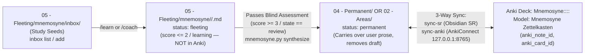

# Mnemosyne Obsidian Vault & Zettelkasten Conventions (`skills/_shared/obsidian-conventions.md`)

> **Binding Vault, Sanctuary, Zettelkasten Graduation & 3-Way Spaced Repetition Sync Specification for `mnemosyne.py`, `/synthesize`, `/learn`, `/review`, `/visualize`, and `/coach`.**
> Enforces `RN-09` (3-Way Spaced Repetition Sync: FSRS-4.5 $\leftrightarrow$ `obsidian-spaced-repetition` $\leftrightarrow$ AnkiConnect), `RN-10` (Vault Sanctuary, Fleeting Graduation & Epistemological Note Structure), `CON-03`..`CON-06`, `ASR-01`, `ASR-04`, `ASR-05`, `SEC-YAML-01`, and `SEC-ANKI-01`.

---

## 1. The Inviolable Vault Sanctuary Law & `05 - Fleeting/` Partition (`CON-03`, `ASR-04`, Exit Code `2`)

Mnemosyne operates directly inside the user's canonical Obsidian Vault (`MNEMOSYNE_VAULT_PATH`, defaulting to `/home/ozymandias/GoogleDrive/Obsidian/Vault` or submodule `<repo>/vault/Vault`).

The Vault's `05 - Fleeting/` directory is partitioned into two strictly separated zones:
1. **`05 - Fleeting/quicknotes/` (and any path in `05 - Fleeting/` outside `05 - Fleeting/mnemosyne/`):**
   - Used by the user's **Omarchy QuickNote widget** (`~/.config/omarchy/shell.json`) and personal fleeting thoughts.
   - **Strictly Protected Sanctuary (`Exit Code 2`).**
2. **`05 - Fleeting/mnemosyne/`:**
   - Dedicated Mnemosyne Fleeting workspace supporting the **Study Inbox** (`05 - Fleeting/mnemosyne/inbox/`) and **Full Zettelkasten Graduation** (`05 - Fleeting/mnemosyne/<Topic>/<Node Title>.md` $\rightarrow$ `02 - Areas/` or `04 - Permanent/`).

> [!CAUTION]
> **HARD SANCTUARY & AIR-GAP BLOCK — EXIT CODE `2`**
> 1. **Vault Sanctuaries:**
>    - **`05 - Fleeting/quicknotes/`** (Omarchy QuickNote widget directory configured in `~/.config/omarchy/shell.json`)
>    - **Any file or subdirectory inside `05 - Fleeting/` OUTSIDE `05 - Fleeting/mnemosyne/`** (e.g., `05 - Fleeting/secret.md`, `05 - Fleeting/personal/`)
>    - **`.git/`** (Git repository internals)
>    - **`.obsidian/`** (Obsidian workspace, plugin binaries, and hotkeys)
> 2. **Loopback Air-Gap (`SEC-ANKI-01`):**
>    - `sync-anki` permits **only** local loopback AnkiConnect endpoints (`http://127.0.0.1:8765`, `localhost`, `::1`). Any non-loopback or external URL immediately terminates with **Exit Code `2`**.

---

## 2. Canonical Vault Folder Taxonomy & Zettelkasten Graduation Lifecycle (`CON-05`)

All Mnemosyne reads and writes are strictly confined to the following directory taxonomy:

| Vault Directory | Access Mode | Role, Lifecycle Stage & File Naming Convention |
| :--- | :---: | :--- |
| **`05 - Fleeting/quicknotes/`** *(and `05 - Fleeting/*` outside `mnemosyne/`)* | **FORBIDDEN (`Exit 2`)** | **Inviolable Sanctuary.** Omarchy QuickNote widget (`~/.config/omarchy/shell.json`) and personal scratch notes. Zero reads, zero writes. |
| **`05 - Fleeting/mnemosyne/inbox/`** | Read / Write | **Study Inbox:** Raw study ideas, questions, paper snippets, or topic seeds dropped by the user or via `python3 scripts/mnemosyne.py inbox add`. Surfaced by `/coach` and `/learn` via `python3 scripts/mnemosyne.py inbox list`. |
| **`05 - Fleeting/mnemosyne/<Topic>/`** | Read / Write | **Fleeting Study Drafts (`status: fleeting`):** `05 - Fleeting/mnemosyne/<Topic>/<Node Title>.md`. Holds in-progress / unmastered nodes (`learning`, `relearning`, `score <= 2`, or stashed drafts). **Never pushed to Anki before comprehension.** |
| **`00 - Maps of Content/`** | Read / Write | **Topic Maps of Content:** `<Sanitized Topic Title> MoC.md` (e.g., `Raft Distributed Consensus MoC.md`). Contains topic progress summary, mastery table, and a Mermaid dependency DAG (`flowchart TD`) with live status badges (`✅`, `🔄`, `🔒`) and `[[Wikilinks]]`. |
| **`02 - Areas/<Domain>/<Topic>/`** *(or `02 - Areas/<Domain>/`)* | Read / Write | **Graduated Domain Notes (`status: permanent`):** Compiled when `note_target == "02 - Areas"` and the node passes blind assessment (`score >= 3` / `review` state). Eligible for `sync-anki` push to `Mnemosyne::<Domain>::<Topic>`. |
| **`04 - Permanent/`** | Read / Write | **Graduated Evergreen Notes (`status: permanent`):** `04 - Permanent/<Sanitized Node Title>.md`. Compiled when `note_target == "04 - Permanent"` (default) and the node passes blind assessment (`score >= 3` / `review` state). Eligible for `sync-anki` push to `Mnemosyne::<Domain>::<Topic>`. |
| **`99 - Meta/00 - Templates/`** | **Read-Only** | User's Obsidian note templates (read-only reference; never overwritten). |
| **`99 - Meta/attachments/`** | Read / Write | Self-verified visual artifacts: `<topic>-<node>.svg` (or `viz-<slug>-<ts>.svg`) and `<topic>-<node>-explorable.html` (or `viz-<slug>-<ts>.html`), plus `report.html` dashboard. |
| **`99 - Meta/mnemosyne-state/`** | Read / Write | **Single Authoritative State Ledger (`HLD-01`):**<br>• `.mnemosyne.lock` (PID-checked POSIX advisory mutex)<br>• `learner-model.json` (FSRS-4.5 $W[0..16]$, retention target, preferences)<br>• `topics/<slug>.json` (Curriculum DAG, node rubrics, FSRS state, OCC metadata, `anki_note_id`, `anki_card_id`)<br>• `receipts/<slug>.jsonl` (Append-only cryptographic receipt ledger)<br>• `stash.jsonl` (Crash-safe ungraded learner productions)<br>• `misconceptions.json` & `experiments.json`<br>• `conflicts/<slug>--<node>--<ts>.md` (OCC & managed-block conflict snapshots) |

### 2.1 Full Zettelkasten Graduation & Anki Promotion Workflow



1. **Stage 0 — Study Inbox (`05 - Fleeting/mnemosyne/inbox/`):**
   - The user (or `python3 scripts/mnemosyne.py inbox add`) captures raw study questions, curiosity gaps, or reading notes in `05 - Fleeting/mnemosyne/inbox/`.
   - `/coach` and `/learn` inspect `python3 scripts/mnemosyne.py inbox list` to propose new topics or link inbox items into active curriculum DAGs.
2. **Stage 1 — Fleeting Study Draft (`05 - Fleeting/mnemosyne/<Topic>/<Node Title>.md`):**
   - While a node is in acquisition or recovery (`state` in `learning` or `relearning`, `score <= 2` on blind assessment, or has a stashed production not yet graduated), `mnemosyne.py synthesize` writes the note to `05 - Fleeting/mnemosyne/<Topic>/<Node Title>.md` with YAML `status: fleeting`.
   - **Pedagogical Guardrail:** Fleeting drafts (`status: fleeting`) are **never** pushed to Anki before comprehension is verified.
3. **Stage 2 — Graduation to Permanent (`02 - Areas/` or `04 - Permanent/`) & Anki Deck Promotion:**
   - Once the node passes blind assessment (`score >= 3` / `state == "review"`), running `python3 scripts/mnemosyne.py synthesize` **automatically graduates** the note from `05 - Fleeting/mnemosyne/<Topic>/<Node Title>.md` to `04 - Permanent/<Node Title>.md` or `02 - Areas/<Domain>/<Topic>/<Node Title>.md` (`status: permanent`), carrying over 100% of user YAML keys and prose outside `<!-- mnemosyne:start/end -->` and removing the fleeting draft.
   - Once graduated (`status: permanent`), `python3 scripts/mnemosyne.py sync-anki` exports the card to Anki deck `Mnemosyne::<Domain>::<Topic>` (model `Mnemosyne Zettelkasten`) with its Probe, Unconditional Truth, Motivated Discovery, Learner's Own Words, SVG/PNG media (`storeMediaFile`), and an `obsidian://open?vault=...` deep link button, recording `anki_note_id` and `anki_card_id` in the note's YAML frontmatter.

### 2.2 Slug & Filename Sanitization (`CON-06`)
- **Topic Slugs & Node IDs:** Must match `^[A-Za-z0-9][A-Za-z0-9._-]{0,127}$` (kebab-case recommended, no spaces, slashes, or leading dots).
- **Markdown Filenames (`<Sanitized Title>.md`):** Normalized via Unicode `NFC`, stripped of control characters (`0x00–0x1F`), with filesystem-unsafe characters `/\:*?"<>|` replaced by `-`. The un-sanitized human title is preserved in YAML `title`, `aliases`, and the `# Heading`.

---

## 3. 3-Way Spaced Repetition YAML Frontmatter Contract (`RN-09`, `ASR-05`, `SEC-YAML-01`)

Every compiled note carries a deterministic YAML frontmatter block (`status: fleeting` while in `05 - Fleeting/mnemosyne/<Topic>/`; `status: permanent` once graduated to `02 - Areas/` or `04 - Permanent/`) that bridges **Mnemosyne FSRS-4.5**, **`obsidian-spaced-repetition`** (`sync-sr`), and **AnkiConnect** (`sync-anki`):

```yaml
---
title: "Split-Brain & Quorum Intersection"
status: permanent
aliases:
  - "Split-Brain & Quorum Intersection"
  - "split-brain-impossibility"
tags:
  - review
  - sr/concept
  - mnemosyne/consensus-raft
mnemosyne_schema: 1
mnemosyne_topic: "consensus-raft"
mnemosyne_node: "split-brain-impossibility"
mnemosyne_kind: "concept"
mnemosyne_sid: "st-20261018T141205Z-a9f3c1"
mnemosyne_body_hash: "e3b0c44298fc1c149afbf4c8996fb92427ae41e4649b934ca495991b7852b855"
fsrs_state: "review"
fsrs_stability: 3.7145
fsrs_difficulty: 5.1618
fsrs_due: "2026-10-22"
fsrs_last: "2026-10-18"
fsrs_reps: 1
fsrs_lapses: 0
sr-due: 2026-10-22
sr-interval: 4
sr-ease: 222
anki_note_id: 1729260001234
anki_card_id: 1729260005678
---
```

### 3.1 Span-Preserving YAML & 3-Way Sync Rules (`SEC-YAML-01`, `SEC-ANKI-01`)
1. **User-Owned Keys Preserved Byte-for-Byte:** Any custom YAML keys added by the user (e.g., `cssclasses`, `up: "[[Distributed Systems MoC]]"`, custom `tags` or `aliases`) are preserved untouched across re-syntheses and across graduation from `05 - Fleeting/mnemosyne/<Topic>/` to `02 - Areas/` or `04 - Permanent/`.
2. **Lifecycle `status` Property:**
   - `status: fleeting` on drafts in `05 - Fleeting/mnemosyne/<Topic>/<Node Title>.md` (`learning`, `relearning`, `score <= 2`, or stashed drafts).
   - `status: permanent` on graduated notes in `02 - Areas/` and `04 - Permanent/` (`score >= 3` / `review` state).
3. **Unquoted `sr-*` Scalars (`obsidian-spaced-repetition` Bridge — `sync-sr`):**
   - `sr-due` is emitted as an unquoted ISO date (`sr-due: YYYY-MM-DD`), `sr-interval` as an integer $\ge 1$, and `sr-ease` as $\text{round}(300 - \frac{D - 1.0}{9.0} \times 170) \in [130, 300]$.
   - External Obsidian SR reviews (`sr-due != fsrs_due` while `mnemosyne_sid == node.last_sid`) are reconciled by `sync-sr` into FSRS-4.5 with `source: "obsidian-sr"`.
4. **Direct Bi-Directional AnkiConnect Sync (`sync-anki`):**
   - **Command:** `python3 scripts/mnemosyne.py sync-anki [--topic <slug>] [--anki-url <url>] [--strict] [--dry-run]`
   - **Loopback Air-Gap (`SEC-ANKI-01`):** Only loopback URLs (`http://127.0.0.1:8765`, `localhost`, `::1`) are permitted; any external host immediately exits with **Exit Code `2`**.
   - **Graceful Offline Mode:** When Anki Desktop is closed, `sync-anki` returns `{"ok": true, "anki_online": false, "status": "skipped_offline"}` with **Exit Code `0`** (unless `--strict` is passed) so `/review`, `/synthesize`, and `/coach` never break when Anki is not running.
   - **Outbound Push (`Graduated Notes Only`):** Pushes `status: permanent` notes (`score >= 3`) to deck `Mnemosyne::<Domain>::<Topic>` (model `Mnemosyne Zettelkasten`) with Probe, Unconditional Truth, Motivated Discovery, Learner's Own Words, SVG/PNG media via `storeMediaFile`, and an `obsidian://open?vault=...` deep link button, persisting `anki_note_id` and `anki_card_id` into both `topics/<slug>.json` and the Obsidian note's YAML frontmatter.
   - **Inbound Pull (`AnkiMobile / AnkiDroid / Anki Desktop -> Mnemosyne -> Obsidian SR`):** Pulls new reviews via `getReviewsOfCards`, logs append-only receipts with `source: "anki"` (excluded from blind-graded `retention` and `refit` telemetry), updates FSRS-4.5 state, and synchronizes `fsrs_*` and `sr-due` / `sr-interval` / `sr-ease` in the Obsidian note frontmatter.

---

## 4. Managed Block Rules (`<!-- mnemosyne:start/end -->`) & OCC Safety (`RN-10`, `NFR-07`)

Every compiled note (both fleeting drafts in `05 - Fleeting/mnemosyne/<Topic>/` and graduated permanent notes in `02 - Areas/` or `04 - Permanent/`) separates **Mnemosyne-managed epistemological synthesis** from **user-owned freeform Zettelkasten prose**:

```markdown
# <Human Node Title>

<!-- mnemosyne:start -->
> [!important] Unconditional Truth
> <Caveat-free universal statement or generative definition ($LaTeX$ enabled)>

## Motivated Discovery
<3Blue1Brown "Pain before Pill" derivation showing how the learner could have invented this bridge>

**Core Claim:** <Declarative testable claim>

**Prerequisites:** [[<Prerequisite Note Title>]] | **Contrasts With:** [[<Contrast Note Title>]] | **Topic MoC:** [[<Topic Title> MoC]]

> [!quote] Learner's Own Words (Verified Receipt `<sid>` · `<YYYY-MM-DD>`)
> <Verbatim learner production from the latest receipt or stashed draft>

## Visual Model
```mermaid
<Validated Mermaid diagram if node.mermaid_block is present>
```
![[<Attached SVG or Explorable HTML if node.artifact is present>|500]]

> [!warning] Misconceptions & Traps Overcome
> - <Resolved/logged misconceptions and contrast boundaries>
<!-- mnemosyne:end -->

## Personal Notes & Further Connections
(User-authored prose, backlinks, literature citations, and code snippets outside the managed markers are 100% preserved across all re-syntheses AND carried over automatically when graduating from `05 - Fleeting/mnemosyne/<Topic>/` to `02 - Areas/` or `04 - Permanent/`.)
```

### 4.1 Optimistic Concurrency Control (OCC) & Corruption Guards (`AC-SYNTH-04`)
1. **5 Epistemological Blocks Inside Managed Markers:**
   - `[!important] Unconditional Truth`
   - `## Motivated Discovery` (with Core Claim & Prerequisite/MoC wikilinks)
   - `[!quote] Learner's Own Words (Verified Receipt)`
   - `## Visual Model` (only rendered when a verified Mermaid block or attachment exists)
   - `[!warning] Misconceptions & Traps Overcome`
2. **Marker Escape Sanitization (`SEC-MD-*`):**
   - Any literal occurrence of `<!-- mnemosyne:start -->`, `<!-- mnemosyne:end -->`, or standalone YAML fences `\n---\n` inside untrusted learner productions or rationales is neutralized before compilation so it can never break the managed block parser.
3. **Malformed File Halt (Exit Code `3`):**
   - If an existing target `.md` file has corrupted YAML frontmatter (missing closing `---`) or mismatched/inverted `<!-- mnemosyne:start -->` / `<!-- mnemosyne:end -->` markers, `mnemosyne.py synthesize` refuses to clobber the file and exits with **Exit Code `3`**.
4. **Conflict Snapshotting (`99 - Meta/mnemosyne-state/conflicts/`):**
   - If the SHA-256 hash of the existing content inside `<!-- mnemosyne:start --> ... <!-- mnemosyne:end -->` differs from `mnemosyne_body_hash` (meaning the user manually edited inside the managed block), or if `st_mtime_ns` changed concurrently during synthesis, `mnemosyne.py` snapshots the full prior file to `99 - Meta/mnemosyne-state/conflicts/<slug>--<node>--<timestamp>.md` before performing an atomic `.mnemosyne_tmp_*` $\rightarrow$ `os.fsync` $\rightarrow$ `os.replace` update.
