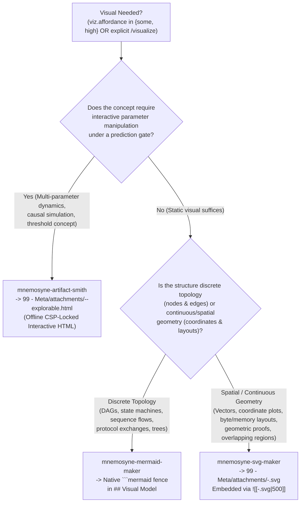

# Mnemosyne Visual Routing & Self-Verifying Artifact Protocol (`skills/_shared/visual-routing.md`)

> **Binding Visual Protocol for `/visualize`, `/learn`, `mnemosyne-mermaid-maker`, `mnemosyne-svg-maker`, and `mnemosyne-artifact-smith`.**
> Enforces `RN-08` (Self-Verified Visuals Earn Their Keep), `FR-10` (Self-Verifying Visual Subagent Pipeline), `ASR-03` (Native Mermaid & Offline CSP), and `NFR-02` (100% Offline Air-Gapped Artifacts).

---

## 1. The Content-Affordance Gate: When to Visualize (`RN-08`)

A visual earns its place in an Obsidian note **only** when it externalizes a topological, spatial, or causal structure that prose and LaTeX equations cannot carry alone. Decorative diagrams hurt retention (Mayer's coherence principle: seductive details yield $g \approx -0.16 \text{ to } -0.33$).

| `viz.affordance` | Meaning | Action |
| :--- | :--- | :--- |
| **`"none"`** | Purely verbal, algebraic, or axiomatic claim where a single sentence or `$LaTeX$` equation is already maximally clear. | **Do not generate a visual.** Never decorate. |
| **`"some"`** | Structural dependency, state transition, memory layout, or geometric relationship where a static diagram compresses multi-node relations. | Route to **`mnemosyne-mermaid-maker`** or **`mnemosyne-svg-maker`**. |
| **`"high"`** | Threshold concept (`threshold: true`) or multi-parameter causal/spatial system where manipulating parameters under a prediction gate kills a persistent misconception. | Route to **`mnemosyne-artifact-smith`** (when `settings.artifacts` permits or user requests) or static maker (`mermaid`/`svg`) for immediate inline dual-coding. |

---

## 2. Tri-Modal Content-Affordance Decision Matrix



### 2.1 Detailed Routing Matrix

| Maker Subagent | Target Content Affordances | Output Format & Vault Location | Obsidian Note Integration (`## Visual Model`) |
| :--- | :--- | :--- | :--- |
| **`mnemosyne-mermaid-maker`** | • Epistemic prerequisite DAGs (`flowchart TD` / `LR`)<br>• Distributed protocol exchanges (`sequenceDiagram`)<br>• Finite state machines (`stateDiagram-v2`)<br>• Relational schemas (`erDiagram`, `classDiagram`) | Validated native ```` ```mermaid ```` fenced block (stored on `node.mermaid_block` in `topics/<slug>.json`). | Embedded directly as a native ```` ```mermaid ```` block inside `<!-- mnemosyne:start/end -->` so Obsidian themes (light/dark) and text search work natively. |
| **`mnemosyne-svg-maker`** | • Exact coordinate geometry, vectors, hyperplanes, projections<br>• Contiguous byte/memory layouts, ring buffers, B-tree page slots, packet headers<br>• Function plots, probability distributions, phase portraits, Venn/quorum intersections | Staged to `/tmp/viz-output.svg` $\rightarrow$ registered via `mnemosyne.py artifact set` into `99 - Meta/attachments/<topic>-<node>.svg` (or timestamped `viz-<slug>-<ts>.svg`). | Embedded via Obsidian wikilink:<br>`![[<topic>-<node>.svg\|500]]` |
| **`mnemosyne-artifact-smith`** | • Multi-parameter causal simulations (`causal-parameter`, `dynamic-process`)<br>• Threshold concepts (`threshold: true`)<br>• Persistent misconceptions (`lapses >= 2`) requiring predict-act-explain falsification | Staged to `/tmp/viz-output.html` $\rightarrow$ registered via `mnemosyne.py artifact set` into `99 - Meta/attachments/<topic>-<node>-explorable.html`. | Linked/embedded via Obsidian wikilink:<br>`![[<topic>-<node>-explorable.html]]` |

---

## 3. Briefing Rules: One Idea, Fewest Elements

The #1 cause of broken or unreadable diagrams is **cramming**. Before dispatching any visual subagent:
1. **Prune to $\le 5\text{–}7$ Elements:** For every node, box, or label in your brief, ask: *"If I delete this element, does the core mechanism still come across?"* If yes, delete it.
2. **Keep Node Labels Short:** 2–5 words per node in Mermaid/SVG. Put full sentences in the note's prose, never inside diagram boxes.
3. **Specify the Pedagogical Invariant:** Tell the maker *what must be visually obvious* (e.g., *"Node N3 must visibly sit inside both Quorum A and Quorum B so the learner sees why disjoint majorities are impossible"*).

---

## 4. The 3-Iteration Render-and-Inspect Verification Loop (`AC-VIZ-01`)

No visual subagent may return an unverified artifact. Every maker executes a strict **3-iteration maximum** verification loop:

1. **Iteration 1–3 (Author $\rightarrow$ Validate/Render $\rightarrow$ Inspect):**
   - **Mermaid (`mnemosyne-mermaid-maker`):**
     - Validates syntax rules (quoted labels containing `()[]{}`, valid arrow tokens, acyclic layout, $\le 7$ nodes).
     - If headless renderer (`mmdc` / `@mermaid-js/mermaid-cli`) is available, renders preview PNG to `/tmp/viz-preview-<attempt>.png` and visually inspects for label clipping, crossed edges, or wrong arrow direction.
     - If `mmdc` is absent (Degraded Render Mode), runs deterministic structural/lexical validation (balanced subgraphs, quoted special characters, valid diagram header).
   - **SVG (`mnemosyne-svg-maker`):**
     - Writes standalone XML-valid `<svg viewBox="0 0 W H" xmlns="http://www.w3.org/2000/svg">` to `/tmp/viz-output.svg`.
     - Verifies well-formed XML, non-overlapping bounding boxes, explicit margin padding ($\ge 24\text{px}$), and high-contrast strokes. If `rsvg-convert` / `resvg` / headless Chrome is available, renders `/tmp/viz-preview-<attempt>.png` and inspects visually.
   - **Explorable HTML (`mnemosyne-artifact-smith`):**
     - Writes standalone HTML to `/tmp/viz-output.html`.
     - Verifies the **7-Clause Explorable Contract** and strict **Offline CSP** header (`connect-src 'none'`, zero external URLs/CDNs).
2. **Hard Cap at 3 Iterations (`RESULT: NONE` Fallback):**
   - If the visual still fails inspection after 3 attempts, the subagent immediately aborts and returns `RESULT: NONE`. A missing diagram is always better than a misleading or broken diagram.

---

## 5. The 7-Clause Explorable HTML Contract & Offline CSP (`ASR-03`)

Every interactive HTML artifact generated by `mnemosyne-artifact-smith` MUST enforce all 7 clauses:

1. **Strict Offline Content-Security-Policy (CSP) Tag (`SEC-XSS-*`, `NFR-02`):**
   Must appear in `<head>` verbatim:
   ```html
   <meta http-equiv="Content-Security-Policy" content="default-src 'none'; script-src 'unsafe-inline'; style-src 'unsafe-inline'; img-src data: blob:; font-src data:; connect-src 'none'; frame-src 'none'; object-src 'none'; base-uri 'none'; form-action 'none';">
   ```
   Zero external `<script src="http...">`, `<link href="http...">`, or `fetch()` calls are permitted.
2. **Clause 1 — Prediction Gate:** Opens with an interactive commitment (slider prediction, option click, or numeric guess) that must be locked in before the simulation reveals its behavior.
3. **Clause 2 — Guided Manipulable Model (`Predict -> Act -> Explain`):** Exposes 1–3 causal parameters (`viz.hook`) with a post-manipulation self-explanation prompt. At novice scaffold level, starts with a stepped **worked drive** before free sandbox manipulation.
4. **Clause 3 — Embedded Free-Recall Retrievals:** Contains $\ge 2$ inline free-recall prompts (targeting the node's `probe` and its `requires` edge) with hidden reveal checks.
5. **Clause 4 — Mayer-Minimal Coherence:** Zero decorative animations; explanatory text sits before or after dynamic canvas updates, never moving concurrently over them.
6. **Clause 5 — Dual-Theme Self-Contained Styling:** Supports light and dark modes via CSS custom properties (`prefers-color-scheme: dark` + `data-theme`), keyboard accessible, total size $< 120\text{ KB}$.
7. **Clause 6 & 7 — Blank-Page Reconstruction & CLI Registration:** Ends with a blank-page reconstruction prompt and registers the artifact in the topic ledger via:
   ```bash
   python3 scripts/mnemosyne.py artifact set --topic <T> --node <N> --file /tmp/viz-output.html
   ```
   (Note: `mnemosyne.py artifact set` accepts `--file` or `--path` and copies/tracks the artifact inside `99 - Meta/attachments/`.)
